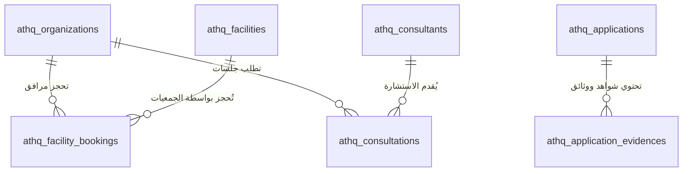

# 🗄️ وثيقة ودليل قاعدة البيانات المركزية - حاضنة ومسرعة عذق
### جمعية البر بالمدينة المنورة (ترخيص رقم 22)

تم تصميم وتطوير قاعدة بيانات علائقية واضحة ومنظمة وشاملة لكافة متطلبات تشغيل حاضنة ومسرعة عذق ومطابقة لخرائط سير العمل **(BPMN Workflows)** والكتيبات الرسمية المعتمدة.

---

## 🏗️ 1. المعمارية المزدوجة (Dual-Engine Architecture)

تعمل قاعدة البيانات بنظام مرن يغطي التشغيل الفوري والإنتاجي:

1. **المحرك الداخلي المباشر (In-Browser Transactional IndexedDB Engine):**
   - مُضمن داخل المنصة في ملف [`public/js/db.js`](file:///c:/Users/Marwan/.gemini/antigravity-ide/scratch/athq-incubator-platform/public/js/db.js).
   - لا يتطلب تثبيت أي خوادم أو برامج خارجية ويعمل مباشرة في المتصفح وعبر GitHub Pages.
   - يدعم المعاملات (Transactions)، والفهارس السريعة (Indexes)، وعمليات (CRUD) الكاملة.
   - يدعم التصدير الفوري لكامل البيانات بصيغة **SQL Dump (`.sql`)** أو **JSON Backup**.

2. **المخطط العلائقي القياسي (Standard Relational SQL DDL):**
   - ملف المخطط الهيكلي: [`database/schema.sql`](file:///c:/Users/Marwan/.gemini/antigravity-ide/scratch/athq-incubator-platform/database/schema.sql)
   - ملف بيانات التغذية الرسمية المعتمدة: [`database/seeds.sql`](file:///c:/Users/Marwan/.gemini/antigravity-ide/scratch/athq-incubator-platform/database/seeds.sql)
   - متوافق مع: **PostgreSQL**, **MySQL 8.0+**, **MariaDB**, وخدمات **Supabase**.

---

## 📊 2. هيكل الجداول وقاموس البيانات (Data Dictionary)

تتألف قاعدة البيانات من **14 جدولاً رئيسياً** مترابطة ومنظمة:

| # | اسم الجدول (SQL Table) | مخزن IndexedDB | الوصف والدور في المنظومة | المفتاح الأساسي |
|---|---|---|---|---|
| **1** | `athq_organizations` | `organizations` | دليل الجمعيات والكيانات الأهلية (المحتضنة والخريجون) | `id` (VARCHAR) |
| **2** | `athq_applications` | `applications` | طلبات الانضمام والاحتضان وسير مراحل BPMN الأربع | `id` (VARCHAR) |
| **3** | `athq_application_evidences` | `evidences` | الشواهد والوثائق وخطابات الامتثال المرفوعة | `id` (VARCHAR) |
| **4** | `athq_facilities` | `facilities` | المرافق والتجهيزات (القاعات، المكاتب 13+، مساحات العمل) | `id` (VARCHAR) |
| **5** | `athq_facility_bookings` | `bookings` | حجوزات ومواعيد استخدام القاعات والمقرات | `id` (VARCHAR) |
| **6** | `athq_consultants` | `consultants` | شبكة المستشارين والخبراء وساعات الخبرة والتقييم | `id` (VARCHAR) |
| **7** | `athq_consultations` | `consultations` | الجلسات الاستشارية المجدولة وتقارير التوصيات | `id` (VARCHAR) |
| **8** | `athq_100days_roadmaps` | `roadmaps` | خطة الـ 100 يوم الأولى لتسريع وتمكين الجمعيات المحتضنة | `id` (VARCHAR) |
| **9** | `athq_service_requests` | `service_requests` | طلبات الخدمات والحزم التشغيلية الواردة من الجمعيات | `id` (VARCHAR) |
| **10** | `athq_announcements_events` | `announcements` | اللقاءات والبرامج التدريبية والتعاميم العاجلة | `id` (VARCHAR) |
| **11** | `athq_contact_inquiries` | `contact_messages` | استفسارات التواصل (الأفراد والمواطنين والجهات) | `id` (VARCHAR) |
| **12** | `athq_notifications` | `notifications` | التنبيهات والإشعارات اللحظية لمستخدمي النظام | `id` (VARCHAR) |
| **13** | `athq_audit_logs` | `audit_logs` | سجل التدقيق وتتبع العمليات وتوثيق قرارات الإدارة | `id` (VARCHAR) |
| **14** | `athq_users` | `users` | إدارة المستخدمين والهوية والصلاحيات وسجلات الدخول | `id` (VARCHAR) |

---

## 🔑 3. العلاقات والمفاتيح الأجنبية (Relationships & Foreign Keys)



---

## 💻 4. استوديو ومستكشف قاعدة البيانات في لوحة الإدارة (Database Studio)

تم توفير تبويب خاص داخل **لوحة الإدارة (Admin Portal)** باسم **"قاعدة البيانات المركزية"** يتيح:
1. **استعراض وتصفية السجلات** لجميع الجداول في واجهة رسومية سريعة.
2. **البحث اللحظي** بالاسم، أو رقم الترخيص، أو الحالة.
3. **إضافة سجل جديد** بنقرة زر وبحقول مخصصة لكل جدول.
4. **حذف أو تعديل السجلات** مباشرة مع التوثيق في سجل التدقيق `audit_logs`.
5. **تصدير كود SQL جاهز بنقرة زر واحدة** (`تحميل قاعدة البيانات SQL`).
6. **تصدير واستيراد النسخ الاحتياطية** بصيغة `JSON`.
7. **لوحة الربط السحابي (Supabase Cloud Sync)** لإدخال مفاتيح المشروع السحابي ومزامنتها.

---

## 🚀 5. طريقة تشغيل ونشر قاعدة البيانات على الخوادم

### أ) على خادم MySQL / MariaDB (أو phpMyAdmin):
1. افتح phpMyAdmin أو MySQL Workbench.
2. أنشئ قاعدة بيانات جديدة:
   ```sql
   CREATE DATABASE athq_incubator CHARACTER SET utf8mb4 COLLATE utf8mb4_unicode_ci;
   USE athq_incubator;
   ```
3. قم باستيراد ملف [`database/schema.sql`](file:///c:/Users/Marwan/.gemini/antigravity-ide/scratch/athq-incubator-platform/database/schema.sql) لإنشاء الجداول.
4. قم باستيراد ملف [`database/seeds.sql`](file:///c:/Users/Marwan/.gemini/antigravity-ide/scratch/athq-incubator-platform/database/seeds.sql) لتعبئة البيانات الرسمية.

### ب) على Supabase / PostgreSQL:
1. افتح لوحة التحكم في Supabase ثم انتقل إلى **SQL Editor**.
2. انسخ محتويات ملف [`database/schema.sql`](file:///c:/Users/Marwan/.gemini/antigravity-ide/scratch/athq-incubator-platform/database/schema.sql) ونفذها (Run).
3. انسخ محتويات ملف [`database/seeds.sql`](file:///c:/Users/Marwan/.gemini/antigravity-ide/scratch/athq-incubator-platform/database/seeds.sql) ونفذها (Run).
4. انسخ رابط المشروع `Project URL` والمفتاح العام `Anon Key` وضعهما في خانة **الربط السحابي** في لوحة إدارة المنصة.
